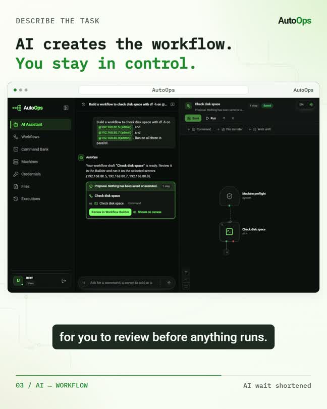
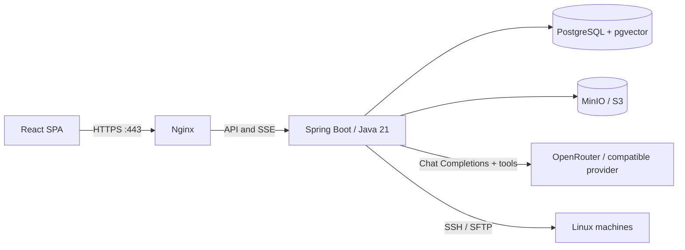

<div align="center">



**Describe the task. Review the workflow. Run across your servers.**

[](#tech-stack) [](#tech-stack) [](#tech-stack) [](#installation)

[Features](#what-you-can-do) · [Installation](#installation) · [AI setup](docs/AI_SETUP.md) · [First workflow](docs/FIRST_RUN.md) · [Documentation](#documentation)

</div>

## What is AutoOps?

AutoOps is a self-hosted application for managing Linux machines over SSH. It helps reduce tedious, repetitive work when you manage many servers. Select your targets, prepare one workflow and follow one execution with preflight checks, approvals and results for each machine.

You can build workflows manually or describe the task to an AI assistant. Tag your servers with `@`, review the proposed steps, save the workflow and explicitly start the run. The assistant can propose commands, machines and workflows; it does not independently save those proposals or execute them.

## Demo

The demo follows a disk-space check from a regular terminal to an AI-created workflow running on three Linux servers in parallel.

[](.github/assets/autoops-demo.mp4)

**[Watch / download the full-quality demo](https://github.com/ilayadmoni/AutoOps/raw/refs/heads/main/.github/assets/autoops-demo.mp4)** — 45 seconds · 1080 × 1350 · voiceover and subtitles.

## What you can do

| Feature | Details |
| --- | --- |
| **AI operations chat** | Describe tasks, tag machines, attach stored files, answer clarification questions and review workflow proposals alongside a visual preview. |
| **Command Bank** | Search Linux commands, create entries, supply typed parameters and preview their server-resolved command. Referenced Command Bank entries must be approved to run. |
| **Visual workflows** | Combine Command, File Transfer and Wait Until steps, including custom shell commands, success/failure branches and per-step settings. |
| **Execute across machines** | Preflight checks, concurrency of up to three machines per execution, approval gates, live progress, stop, retry and stored stdout/stderr with exit codes. |
| **Machine inventory** | SSH connection checks, folders, favorites and session imports, with encrypted password credentials. |
| **SSH host trust** | Explicit fingerprint confirmation and first-use pinning during preflight for eligible new machines. Changed, revoked or retargeted trust requires manual review. |
| **Files and folders** | S3-compatible storage, folder packages and SFTP transfers with checksum verification. |
| **Administration** | User management, dataset imports/review, environment overview and a sanitized audit log. |
| **Interface** | English and Hebrew, LTR/RTL layouts, light/dark themes and persisted conversations. |

Custom commands are shell instructions reviewed by the operator; validation and risk gates do not make arbitrary shell code harmless. The backend enforces ownership, command resolution, host verification and approvals.

## Installation

### Quick install — Windows and macOS

Install **Git** and **Docker Desktop**, start Docker Desktop with Linux containers, then clone the repository:

```bash
git clone https://github.com/ilayadmoni/AutoOps.git
cd AutoOps
```

**Windows — PowerShell 5.1 or later:**

```powershell
powershell -NoProfile -ExecutionPolicy Bypass -File .\install.ps1
```

**macOS — Terminal:**

```bash
bash install.sh
```

The interactive installer asks for your HTTPS hostname/port, administrator username/password and AI provider base URL, API key and model ID. **Passwords and API keys are entered privately at runtime**, never shipped in the repository. Choose `n` at the AI prompt to install without AI.

It generates independent database/storage passwords and JWT/encryption keys, creates a local HTTPS CA/certificate, builds the images and waits for service readiness. Python, Bash and OpenSSL run inside a temporary Docker helper; no host installation of these tools is required for the quick path.

Trust `deploy/tls/ca.crt` on your device, then open the HTTPS address you selected and sign in with your administrator credentials. See [certificate trust instructions](docs/QUICK_INSTALL.md#trust-the-local-certificate).

Settings are saved in **`deploy/docker-compose.local.yml`**, which is excluded from Git. Re-running the installer reuses that file and preserves secrets. Back it up together with `deploy/tls/`; changing the encryption key makes saved SSH credentials unreadable. Existing deployments should follow the [update guide](docs/DEPLOYMENT.md), not regenerate secrets.

[Quick-install details and troubleshooting](docs/QUICK_INSTALL.md) · [Complete manual installation guide](docs/INSTALLATION.md)

### Manual installation

The manual path below uses Bash and host OpenSSL; on Windows, use WSL 2 with Docker Desktop integration. The quick installer above works directly in PowerShell.

### What you need

- **Docker with Docker Compose** and a running Docker daemon using Linux containers. Install [Docker Desktop](https://docs.docker.com/desktop/) or [Docker Engine with the Compose plugin](https://docs.docker.com/compose/install/).
- **Git, Bash and OpenSSL** for cloning and the certificate script. The offline image-export helper also needs Python 3.
- **An OpenRouter API key or another compatible AI provider** to enable the assistant. The provider/model must support Chat Completions and native tool calling. The rest of AutoOps works without AI.
- **A reachable Linux server with SSH** for running tasks. The backend container must be able to reach its address and SSH port; the currently implemented credentials use a username and password.
- Internet access for the first image/dependency build and for cloud AI requests. Offline deployment from exported images is also supported.

Java, Maven, Node.js and Go are installed inside the build images; they are not host requirements for the Docker installation. Native development has [separate prerequisites](docs/DEVELOPMENT.md).

### Installation at a glance

```bash
git clone https://github.com/ilayadmoni/AutoOps.git
cd AutoOps
mkdir -p deploy/certs
bash deploy/generate-tls-cert.sh localhost
# Configure ALL REPLACE values in deploy/docker-compose.yml.
# See docs/CONFIGURATION.md for complete values and secret generation.
docker compose -f deploy/docker-compose.yml -f deploy/docker-compose.build.yml pull postgres
docker compose -f deploy/docker-compose.yml -f deploy/docker-compose.build.yml build
docker compose -f deploy/docker-compose.yml config --quiet
docker compose -f deploy/docker-compose.yml up -d --pull never
docker compose -f deploy/docker-compose.yml ps
```

Install `deploy/tls/ca.crt` as a trusted root on your client device, then open **https://localhost/**. Sign in with the administrator username/password you configured. For another device or hostname, generate the certificate for that host and ensure its DNS/IP resolves to the Docker host.

**Configuration is currently explicit in Compose:** fill the YAML values directly. Copying `.env.example` to `.env` does **not** replace the literal `REPLACE:` values in the supplied Compose file. Keep the configured YAML private; do not commit credentials or API keys.

### Configure AI

In the backend environment in `deploy/docker-compose.yml`, set:

```yaml
AI_BASE_URL: "https://openrouter.ai/api/v1"
AI_API_KEY: "YOUR_PROVIDER_API_KEY"
AI_MODEL: "YOUR_EXACT_TOOL_CAPABLE_MODEL_ID"
AI_SSL_VERIFY: "true"
AI_SSL_CERT_PATH: ""
```

Get your OpenRouter key and model ID using the [AI provider setup guide](docs/AI_SETUP.md). It also explains other OpenAI-compatible providers, local endpoints, provider billing, TLS and testing. Use the API base URL, without `/chat/completions`; AutoOps appends that path.

After changing settings, recreate the backend:

```bash
docker compose -f deploy/docker-compose.yml up -d --pull never --force-recreate backend
```

Leave `AI_API_KEY` and `AI_MODEL` empty to disable the assistant. Keep `EMBEDDING_PROVIDER: "LOCAL"` for offline lexical/hash embeddings; chat AI and command-search embeddings are configured separately.

## Your first workflow

1. Sign in, create an SSH credential and add a machine using an address reachable from the backend container.
2. Discover its SSH fingerprint, compare it with the host's own fingerprint and confirm it; run the connection test.
3. Add a second machine if you want to try a multi-server run.
4. Open the assistant, select the machines with `@` and ask: **"Build a workflow to check disk space with df -h on these servers."**
5. Review the draft, save it, confirm targets and start the workflow. Follow preflight, any required approval and both results.

See [the first-run walkthrough](docs/FIRST_RUN.md) for the manual path and connection troubleshooting.

## Architecture



The browser and assistant submit requests; the backend controls execution. Stored SSH passwords are encrypted with AES-256-GCM and excluded from AI tool responses. Chat prompts, machine metadata and selected tool results can go to the configured AI provider. Review what you include in messages and outputs.

## Tech stack

| Layer | Technology |
| --- | --- |
| Frontend | React 19, TypeScript, Vite 7, TanStack Query, React Router, React Flow, Motion, Lucide |
| Backend | Java 21, Spring Boot 3.5, Spring Security, JPA, Flyway |
| Data and storage | PostgreSQL 16 + pgvector, MinIO/S3-compatible storage |
| Remote operations | JSch SSH/SFTP, host-key pinning, preflight and approval policy |
| Delivery | Docker Compose, Nginx HTTPS, GitHub Actions backend tests and frontend build |

## Documentation

| Start or operate | Understand or develop |
| --- | --- |
| [Installation](docs/INSTALLATION.md) | [Architecture](docs/ARCHITECTURE.md) |
| [Configuration values](docs/CONFIGURATION.md) | [API](docs/API.md) |
| [AI provider setup](docs/AI_SETUP.md) | [AI behavior](docs/AI.md) |
| [First login and workflow](docs/FIRST_RUN.md) | [Execution engine](docs/EXECUTION_ENGINE.md) |
| [Troubleshooting](docs/TROUBLESHOOTING.md) | [Security](docs/SECURITY.md) |
| [Deployment, backups and updates](docs/DEPLOYMENT.md) | [Native development](docs/DEVELOPMENT.md) |
| [Offline image export](deploy/README.md) | [Database](docs/DATABASE.md) · [Frontend](docs/FRONTEND.md) · [Prompts](docs/PROMPTS.md) |

For checks and contribution workflows, see [development instructions](docs/DEVELOPMENT.md). The [documentation index](docs/README.md) lists the remaining references and historical implementation plan.

---

**Built by [Ilay Admoni](https://github.com/ilayadmoni)** — Computer Science student and software engineer, drawing on hands-on Linux and VMware infrastructure experience.

[GitHub](https://github.com/ilayadmoni) · [Email](mailto:ilayadmoni9@gmail.com) · [LinkedIn](https://www.linkedin.com/in/ilay-admoni-11010145252572577252/)
